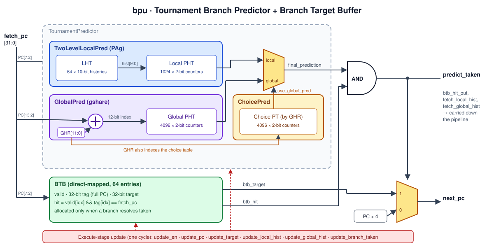
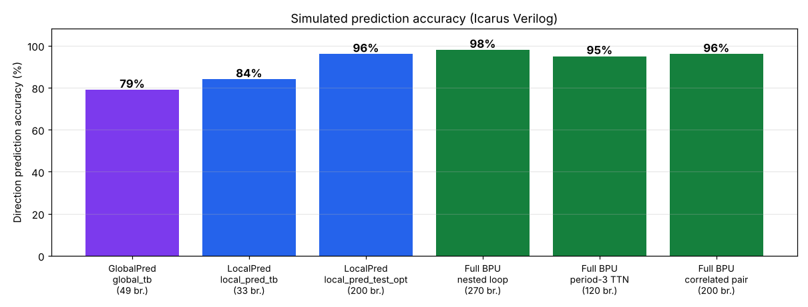

# Tournament Branch Prediction Unit (Verilog)

A parameterised **tournament branch predictor with a Branch Target Buffer**, written in synthesisable Verilog for a pipelined RISC-V core. Following the scheme used in the Alpha 21264, it runs a per-branch **two-level local predictor** and a **gshare global predictor** in parallel, and a **choice predictor** learns which of the two to trust for each global-history pattern. A direct-mapped **BTB** supplies the target address, so the unit produces a full `next_pc` in the fetch stage.

| | |
|---|---|
| **Top module** | `bpu` (`bpu_top.v`) |
| **Direction predictor** | Tournament: local (PAg) + global (gshare) + choice |
| **Local predictor** | 64-entry × 10-bit local history table → 1024 × 2-bit pattern table |
| **Global predictor** | 12-bit GHR ⊕ PC[13:2] → 4096 × 2-bit pattern table |
| **Choice predictor** | 12-bit GHR → 4096 × 2-bit selector counters |
| **Target prediction** | 64-entry direct-mapped BTB, full-PC tag, 32-bit target |
| **Prediction latency** | Combinational: same cycle as `fetch_pc` |
| **Update** | One cycle, from the execute stage, using the histories captured at fetch |
| **Total state** | 23,244 bits (about 2.8 KiB) with default parameters |
| **Measured accuracy** | 95 – 98 % direction accuracy on loop and correlated-branch workloads |



---

## Contents

- [Why a tournament predictor](#why-a-tournament-predictor)
- [Architecture](#architecture)
- [Interface](#interface)
- [Integrating with a pipeline](#integrating-with-a-pipeline)
- [Parameters and storage budget](#parameters-and-storage-budget)
- [Verification and results](#verification-and-results)
- [Repository structure](#repository-structure)
- [Running the simulations](#running-the-simulations)
- [Design notes and limitations](#design-notes-and-limitations)

---

## Why a tournament predictor

Different branches are predictable in different ways:

- A **loop-closing branch**, or any branch with a fixed pattern of its own (such as T T N T T N), is best predicted from **its own past outcomes**. That is what the local predictor tracks.
- A branch whose outcome depends on **other recent branches** (for example `if (a) … if (a && b) …`) is best predicted from the **global history** of all branches, which is what gshare captures.

Neither predictor wins everywhere. The tournament scheme keeps both and adds a small table of 2-bit counters that learns, per global-history pattern, which predictor has been right more often.

---

## Architecture

### 1. Two-level local predictor (`LocalPredictor.v` → `TwoLevelLocalPred`)

A **PAg** organisation: per-address histories feeding one global pattern table.

- **Local History Table (LHT):** `2^PC_BITS` entries (64), each a `HIST_BITS`-wide (10-bit) shift register holding the last 10 outcomes of the branches that map to that entry. It is indexed by `PC[PC_BITS+1:2]`; the two LSBs are dropped because instructions are word-aligned.
- **Pattern History Table (PHT):** `2^HIST_BITS` (1024) saturating 2-bit counters, indexed by the history read from the LHT.
- **Predict:** taken if the counter is `10` (weakly taken) or `11` (strongly taken).
- **Update:** the counter selected by `update_history_in` (the history used at fetch) moves one step towards the actual outcome, and the LHT entry of `update_pc` becomes `{update_history_in[HIST_BITS-2:0], branch_taken}`.

### 2. Global predictor (`global_predictor.v` → `GlobalPred`)

A **gshare** predictor.

- **Global History Register (GHR):** `GHR_BITS` (12) most recent branch outcomes.
- **Index:** `PC[PHT_INDEX_BITS+1:2] XOR GHR`. Hashing the PC into the history spreads different branches that share a history across different counters, which reduces destructive aliasing compared with a plain GAg.
- **PHT:** `2^PHT_INDEX_BITS` (4096) 2-bit counters.
- **Update:** recompute the index from `update_pc` and the GHR captured at fetch, update that counter, and set `GHR ← {update_history_in[GHR_BITS-2:0], branch_taken}`.

### 3. Choice predictor (`choice_predictor.v` → `ChoicePred`)

- **Choice Pattern Table (CPT):** `2^GHR_BITS` (4096) 2-bit counters indexed by the GHR. The encoding is `00` strongly local, `01` weakly local, `10` weakly global, `11` strongly global.
- **Select:** `use_global_pred = CPT[GHR][1]`.
- **Update (only when the two predictors disagreed):**
  - only local was correct: decrement, moving towards local;
  - only global was correct: increment, moving towards global;
  - both right or both wrong: no change.

### 4. Branch Target Buffer (`btb.v` → `BTB`)

- Direct-mapped, `2^PC_BITS` (64) entries, each with a valid bit, a 32-bit tag and a 32-bit target, indexed by `PC[PC_BITS+1:2]`.
- **Hit:** the entry is valid and its stored tag equals the full `fetch_pc`, so aliasing can never produce a wrong hit.
- **Allocate:** only when a branch resolves **taken**, which saves entries for branches that are always not taken.

### 5. Top level (`bpu_top.v` → `bpu`)

```verilog
predict_taken = final_prediction & btb_hit;          // need a target to redirect
next_pc       = predict_taken ? btb_target : fetch_pc + INSTR_SIZE;
```

The predicted direction only redirects fetch when the BTB also knows the target. A cold branch, one the BTB has never seen taken, falls through to `PC + 4`.

### Reset state

| Structure | Reset value | Reasoning |
|---|---|---|
| Local and global PHT counters | `10` (weakly taken) | Most dynamic branches (loops) are taken, and a weak state lets the counter flip after one miss |
| LHT entries, GHR | all zeros | — |
| Choice counters | `10` (weakly global) | Start by trusting the global predictor |
| BTB | all entries invalid | — |

Reset is **synchronous and active-high** in every module.

---

## Interface

### `bpu` ports

| Signal | Dir | Width | Stage | Description |
|---|---|---|---|---|
| `clk` | in | 1 | — | Clock |
| `reset` | in | 1 | — | Synchronous, active-high reset |
| `fetch_pc` | in | 32 | IF | PC being fetched |
| `next_pc` | out | 32 | IF | Predicted next PC: `btb_target` if predicted taken, else `fetch_pc + 4` |
| `predict_taken` | out | 1 | IF | Final direction prediction AND BTB hit |
| `btb_hit_out` | out | 1 | IF | BTB holds an entry for `fetch_pc` |
| `fetch_local_hist` | out | `LOCAL_HIST_BITS` | IF | Local history used for this prediction; carry it down the pipeline |
| `fetch_global_hist` | out | `GLOBAL_HIST_BITS` | IF | GHR used for this prediction; carry it down the pipeline |
| `update_en` | in | 1 | EX | High for one cycle when a branch resolves |
| `update_pc` | in | 32 | EX | PC of the resolving branch |
| `update_target` | in | 32 | EX | Actual target of the branch |
| `update_branch_taken` | in | 1 | EX | Actual outcome |
| `update_local_hist` | in | `LOCAL_HIST_BITS` | EX | `fetch_local_hist` captured when this branch was fetched |
| `update_global_hist` | in | `GLOBAL_HIST_BITS` | EX | `fetch_global_hist` captured when this branch was fetched |

---

## Integrating with a pipeline

```
 IF:  fetch_pc ──► bpu ──► next_pc ──► PC register
                    │
                    └─► {predict_taken, fetch_local_hist, fetch_global_hist}
                            │  carried through IF/ID and ID/EX
 EX:  branch resolves ──────┘
        update_en           = is_branch
        update_pc           = PC_EX
        update_target       = computed target
        update_branch_taken = actual outcome
        update_*_hist       = histories carried from IF
        mispredict          = (predict_taken != taken) ||
                              (taken && predicted_target != actual target)
        → on mispredict: flush younger stages and redirect the PC
```

Passing the fetch-time histories back at update time is what keeps training correct when other branches have changed the tables in between.

---

## Parameters and storage budget

| Parameter | Default | Meaning |
|---|---|---|
| `PC_BITS` | 6 | log₂ of the LHT and BTB entry counts (64) |
| `LOCAL_HIST_BITS` | 10 | Local history length, giving 2¹⁰ = 1024 local PHT entries |
| `GLOBAL_HIST_BITS` | 12 | GHR length, giving 2¹² = 4096 global PHT and choice entries |
| `INSTR_SIZE` | 4 | Fall-through increment |

| Structure | Size | Bits |
|---|---|---|
| Local history table | 64 × 10 | 640 |
| Local PHT | 1024 × 2 | 2,048 |
| Global PHT | 4096 × 2 | 8,192 |
| Global history register | 12 | 12 |
| Choice PT | 4096 × 2 | 8,192 |
| BTB (valid + tag + target) | 64 × 65 | 4,160 |
| **Total** | | **23,244 bits ≈ 2.84 KiB** |

The BTB stores the full 32-bit PC as its tag. Storing only `PC[31:PC_BITS+2]` (24 bits) would identify each branch just as exactly and save 512 bits.

---

## Verification and results

Every testbench uses the same model of a pipeline. In the **fetch** cycle it presents `fetch_pc`, records the prediction and the history outputs, and scores the prediction against the known outcome. One clock later, in the **execute** cycle, it pulses `update_en` with the recorded histories and the actual outcome.

### Unit testbenches (in this repository)

| Testbench | DUT (parameters) | Workload | Result |
|---|---|---|---|
| `testbench/global_tb.v` | `GlobalPred` (6-bit PHT, 4-bit GHR) | 10-iteration loop + exit, alternating T/N, interleaved T/N branches, correlated pair | 39 / 49 correct, **79 %** |
| `testbench/local_pred_tb.v` | `TwoLevelLocalPred` (6-bit PC, 4-bit history) | 10-iteration loop + exit, alternating T/N, interleaved T/N branches | 28 / 33 correct, **84 %** |
| `testbench/local_pred_test_opt.v` | `TwoLevelLocalPred` (6-bit PC, 4-bit history) | 40× always-taken, 40× always-not-taken, two independent period-4 patterns (60 each) | 193 / 200 correct, **96 %** |

The short tests are dominated by warm-up. Of the 5 misses in `local_pred_tb`, one is the loop exit, which no counter-based predictor can anticipate after ten taken iterations. The other four are training misses: two while the alternating pattern is learned (after that it is predicted perfectly), and two while the always-not-taken branch moves its counter away from the weakly-taken reset state. The logs in `simulation/` match these runs exactly. `simulation/simulation_results3` comes from a longer variant of the optimised testbench (80 iterations per test) that reached 220 / 240 (**91 %**).

Excerpt from `simulation/resultlogs`, where the local predictor learns an alternating branch:

```
PC: 00000030 | Hist: 0000 | Pred: 1 | Actual: 1 |    CORRECT
PC: 00000030 | Hist: 0001 | Pred: 1 | Actual: 0 | MISPREDICT
PC: 00000030 | Hist: 0010 | Pred: 1 | Actual: 1 |    CORRECT
PC: 00000030 | Hist: 0101 | Pred: 1 | Actual: 0 | MISPREDICT
PC: 00000030 | Hist: 1010 | Pred: 1 | Actual: 1 |    CORRECT
PC: 00000030 | Hist: 0101 | Pred: 0 | Actual: 0 |    CORRECT   ← pattern learned
```

### Full BPU integration test

The complete `bpu` with default parameters (10-bit local history, 12-bit GHR, 64-entry BTB) was simulated on three workloads. A prediction counts as correct only if the direction matches; `next_pc` is also checked against the true next PC, so this measures BTB behaviour as well.

| Workload | Branches | Direction accuracy | `next_pc` accuracy |
|---|---|---|---|
| Nested loop: inner branch taken 7× then exits, outer always taken, 30 outer iterations | 270 | **98 %** | 98 % |
| Single branch with period-3 pattern T T N | 120 | **95 %** | 95 % |
| Two correlated branches (second branch equals the first) | 200 | **96 %** | 96 % |
| **All** | **590** | **96 %** | **96 %** |

The BTB hit rate over the whole run is 98 %. The only misses are the first encounters, before each branch has been taken once.



---

## Repository structure

```
Branch-Prediction-Unit/
├── bpu_top.v                 # Top level: tournament predictor + BTB + next-PC mux
├── Tournament_predictor.v    # Local, global and choice predictors + final mux
├── LocalPredictor.v          # Two-level local predictor (LHT + PHT)
├── global_predictor.v        # gshare global predictor (GHR + PHT)
├── choice_predictor.v        # Choice / meta predictor
├── btb.v                     # Direct-mapped Branch Target Buffer
├── testbench/
│   ├── global_tb.v           # GlobalPred unit test
│   ├── local_pred_tb.v       # TwoLevelLocalPred unit test
│   └── local_pred_test_opt.v # Longer local-predictor test (period-4 patterns)
├── global_tb.v               # Copy of testbench/global_tb.v
├── local_predictor_tb.v      # Copy of testbench/local_pred_tb.v
├── simulation/               # Text logs of the testbench runs
├── docs/                     # Diagram and plot used in this README
└── LICENSE                   # MIT
```

---

## Running the simulations

With [Icarus Verilog](https://steveicarus.github.io/iverilog/):

```bash
# Global predictor unit test
iverilog -g2012 -o global.out testbench/global_tb.v global_predictor.v && vvp global.out

# Local predictor unit tests
iverilog -g2012 -o local.out testbench/local_pred_tb.v LocalPredictor.v && vvp local.out
iverilog -g2012 -o local_opt.out testbench/local_pred_test_opt.v LocalPredictor.v && vvp local_opt.out

# Full BPU (compile check / integration)
iverilog -g2012 -o bpu.out <your_tb>.v bpu_top.v Tournament_predictor.v \
         LocalPredictor.v global_predictor.v choice_predictor.v btb.v
vvp bpu.out
```

<details>
<summary>Full-BPU integration testbench used for the results above</summary>

```verilog
`timescale 1ns/1ps
module tb_bpu;
  reg clk = 0, reset = 1, update_en = 0, taken = 0;
  reg  [31:0] fetch_pc = 0, update_pc = 0, update_target = 0;
  reg  [9:0]  ulh = 0;  reg [11:0] ugh = 0;
  wire [31:0] next_pc;  wire pt, hit;  wire [9:0] flh;  wire [11:0] fgh;

  bpu dut(.clk(clk), .reset(reset), .update_en(update_en), .update_branch_taken(taken),
          .fetch_pc(fetch_pc), .update_pc(update_pc), .update_target(update_target),
          .update_local_hist(ulh), .update_global_hist(ugh), .next_pc(next_pc),
          .predict_taken(pt), .btb_hit_out(hit),
          .fetch_local_hist(flh), .fetch_global_hist(fgh));

  always #5 clk = ~clk;
  integer n = 0, ok_dir = 0, ok_pc = 0;

  task br(input [31:0] pc, input [31:0] tgt, input t);
    reg [9:0] lh; reg [11:0] gh;
    begin
      fetch_pc = pc; #1; lh = flh; gh = fgh;                 // fetch
      n = n + 1;
      if (pt == t) ok_dir = ok_dir + 1;
      if (next_pc == (t ? tgt : pc + 4)) ok_pc = ok_pc + 1;
      @(posedge clk); #1;                                    // execute
      update_en = 1; update_pc = pc; update_target = tgt;
      ulh = lh; ugh = gh; taken = t;
      @(posedge clk); #1; update_en = 0;
    end
  endtask

  integer o, i;
  initial begin
    #15 reset = 0;
    for (o = 0; o < 30; o = o + 1) begin                     // nested loop
      for (i = 0; i < 8; i = i + 1) br(32'h100, 32'h0F0, i < 7);
      br(32'h120, 32'h0E0, 1);
    end
    for (i = 0; i < 120; i = i + 1) br(32'h200, 32'h1C0, (i % 3) != 2);   // T T N
    for (i = 0; i < 100; i = i + 1) begin                    // correlated pair
      br(32'h300, 32'h340, i % 2);
      br(32'h304, 32'h380, i % 2);
    end
    $display("branches=%0d direction=%0d%% next_pc=%0d%%",
             n, ok_dir * 100 / n, ok_pc * 100 / n);
    $finish;
  end
endmodule
```
</details>

---

## Design notes and limitations

- **Choice-predictor training uses the fetch-stage predictions.** `ChoicePred` decides whether the local or global predictor was right by comparing `local_pred_out` and `global_pred_out` with the resolved outcome. Those signals are computed from the current `fetch_pc`, not from `update_pc`. The testbenches keep `fetch_pc` equal to `update_pc` during the update cycle, so they are not affected. In a real pipeline, where fetch has already moved on, the local and global predictions made at fetch should be carried down the pipeline with the histories and fed back at update time.
- **Non-speculative global history.** The GHR changes only when a branch resolves, so two branches in flight at the same time see the same history. This is simple and correct, but it reduces gshare accuracy in a deep pipeline. A speculative GHR, updated with the prediction at fetch and repaired from `update_global_hist` on a mispredict, is the usual improvement.
- **Shared local PHT.** All 64 local histories index one 1024-entry pattern table (PAg), so two branches with the same 10-bit history share a counter. A PAp organisation (separate tables) or hashing PC bits into the index would reduce that interference.
- **Combinational reads.** All tables are read asynchronously, which suits flip-flop or LUT-RAM implementation and gives a same-cycle prediction. Mapping the 4096-entry tables to block RAM would need a registered read, which means predicting one cycle ahead.
- **Reset loops.** Each table is cleared by a `for` loop in a synchronous reset, which synthesises to flip-flops with reset. On an FPGA this costs about 23 k flip-flops; storing the tables in RAM without a reset, or clearing them over several cycles with a state machine, saves most of that.
- **No return address stack.** Returns (`JALR ra`) are predicted through the BTB, so one function called from several places will often be predicted to the wrong return address. A small return address stack would fix this.

---

## Author

**K. S. Sethurathnam**, IIT (BHU) Varanasi

